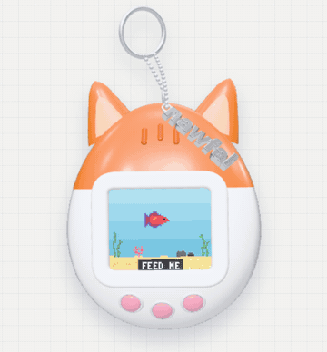

# Portfolio - Mohammad Nawfal Arfa

Portofolio pribadi Mohammad Nawfal Arfa: mahasiswa Linguistik Indonesia di UPN "Veteran" Jawa Timur, video editor, dan pembuat IZZA_ (AI lokal di ponsel).

<p align="center">
  
</p>

Halaman depannya punya virtual pet 3D yang bisa dimainkan, dock ala macOS (works / quests / profile), sticker board, dan halaman proyek dengan daftar isi di samping. Dibuat dengan HTML, CSS, dan JavaScript (plus three.js untuk 3D), tanpa proses build.

## Lihat website

- **Live (GitHub Pages):** https://izzatiin.github.io/portofolio/
- **Preview cepat:** https://raw.githack.com/Izzatiin/portofolio/HEAD/index.html

## Isi

| Bagian | Isi |
| --- | --- |
| Home | Hero "I tell stories in frames." dan virtual pet 3D |
| Works | IZZA_, Simpang Kisah, Web Pertama, Portfolio v1 |
| Quests | Skill, eksperimen kode, sticker board, dan to-do |
| Profile | Foto, bio, dan kontak |

## Virtual pet

Perangkat 3D berbentuk "kucing oren" dengan ikan cupang pixel di layarnya. Perangkat ini ikut miring mengikuti kursor, mengambang pelan, gantungan kuncinya berayun, dan setiap tombol mengeluarkan suara serta efek partikel.

- **FEED**: menjatuhkan makanan, ikan berenang memakannya
- **PLAY**: mini game tebak-tebakan. Ikan sembunyi di balik batu, tebak keluar dari kiri atau kanan
- **SLEEP**: layar meredup dan ikan tidur (tekan lagi untuk **WAKE**)

Klik perangkatnya untuk mode layar penuh (keyboard: F, P, S, panah kiri/kanan, Esc). Tombol **sound on/off** ada di pojok kanan bawah (di HP: kanan atas).

- **Nama di gantungan kunci**: teks di `<span class="pet-tag">` pada `index.html`
- **Warna perangkat 3D**: objek `mat` di `assets/js/pet3d.js`
- **Warna ikan**: `FISH_COLORS` di `assets/js/pet.js`
- **Suara**: `SOUNDS` di `assets/js/pet-fx.js`

Model 3D butuh WebGL dan server (GitHub Pages atau `npx serve .`). Kalau tidak tersedia, otomatis tampil versi 2D.

## Struktur

```
index.html               Halaman utama: home, works, quests, profile (pindah lewat dock)
work/izza.html           Proyek: IZZA_, AI lokal di ponsel (dengan 2 video promo)
work/simpang-kisah.html  Proyek: film pendek Simpang Kisah (video YouTube)
work/web-pertama.html    Proyek: website pertama
work/portfolio-v1.html   Proyek: portofolio versi pertama
assets/css/style.css     Semua styling (warna & font di bagian TOKENS paling atas)
assets/js/pet.js         Logika akuarium pixel dan mini game
assets/js/pet3d.js       Model 3D perangkat (three.js)
assets/js/pet-fx.js      Suara tombol dan efek partikel
assets/js/main.js        Navigasi dock, stiker drag, daftar isi halaman proyek
assets/img/              Foto, cover proyek, dan cuplikan IZZA_
assets/video/            Video promo IZZA_ (sudah dikompres untuk web)
assets/readme/           GIF demo untuk README ini
assets/vendor/           three.js dan font 3D untuk tag nama
```

## Mengubah isi

- **Kontak** (LinkedIn, GitHub, Email) ada di bagian `HEADER` pada `index.html`.
- **Bio dan kontak lain** ada di bagian `PROFILE` pada `index.html`.
- **Foto**: `assets/img/profile.jpg` (juga ikon profile di dock), `about-1.jpg`, `about-2.jpg`.

### Menambah proyek baru

1. Copy salah satu file di `work/`, misalnya `work/izza.html` jadi `work/proyek-baru.html`, lalu ganti isinya.
2. Di `index.html`, copy satu blok `<a class="work-card" ...>` di dalam `works-grid` dan arahkan `href` ke file barunya.
3. Pilih status: `badge--building` (kuning, misalnya "New"), `badge--shipped` (hijau, misalnya "Live"), atau `badge--concept` (biru).
4. Video taruh di `assets/video/`. Kompres dulu supaya ringan, misalnya:

```bash
ffmpeg -i video.mp4 -vf scale=540:-2 -c:v libx264 -crf 27 -c:a aac -b:a 96k -movflags +faststart assets/video/nama.mp4
```

## Menjalankan di komputer sendiri

```bash
npx serve .
```

Atau buka folder ini di VS Code, lalu klik kanan `index.html` → **Open with Live Server**.

## Publish ke GitHub Pages

1. Buka **Settings > Pages** (https://github.com/Izzatiin/portofolio/settings/pages).
2. Di **Source**, pilih **Deploy from a branch**, branch `main`, folder `/ (root)`, lalu **Save**.
3. Tunggu 1-2 menit, lalu buka https://izzatiin.github.io/portofolio/
